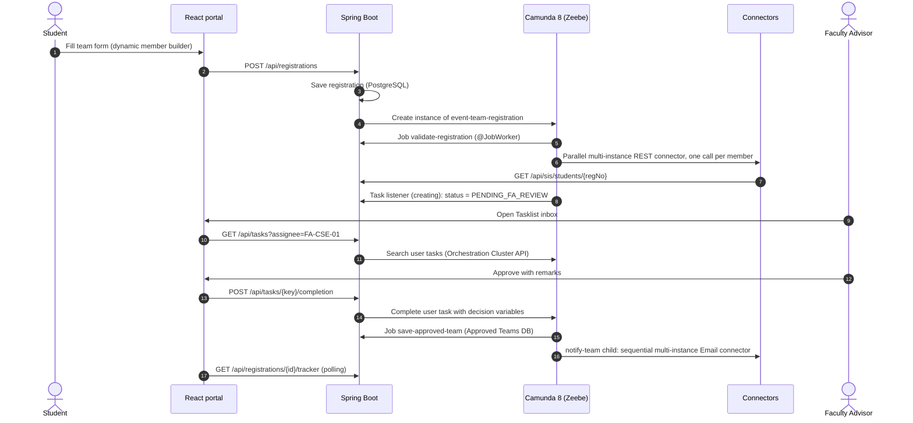
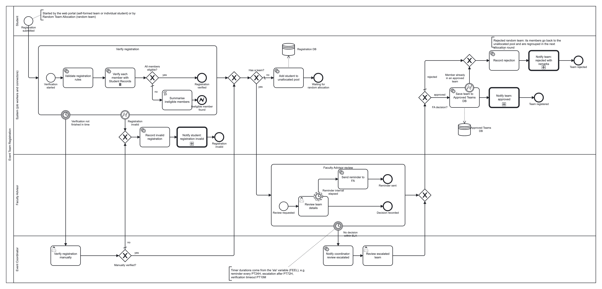
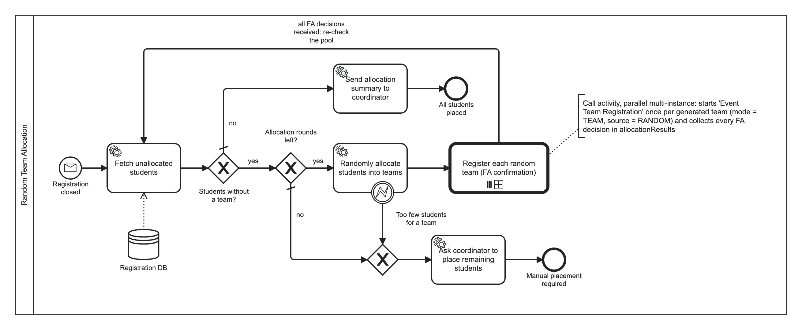
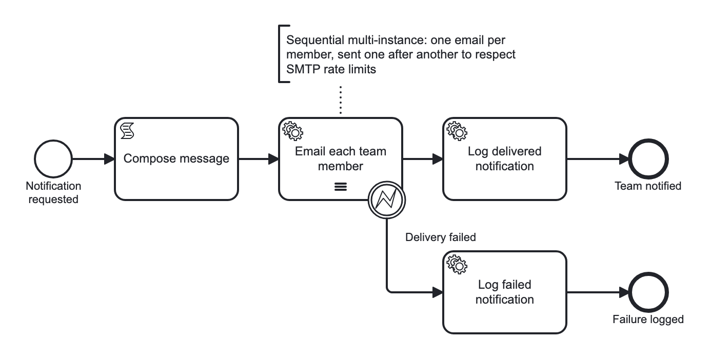
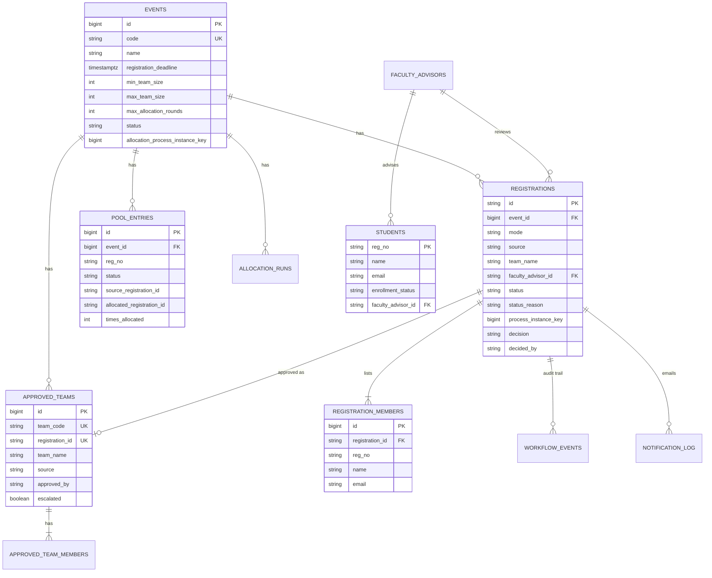

# Event Team Registration and Random Team Allocation

A full-stack workflow automation application built on **Camunda 8.8**, **Spring Boot 3.5**, **React 18** and **PostgreSQL**.

Students register for a college event either as a self-formed team or as individuals. Every team is verified
against the university's Student Records service and approved by its Faculty Advisor (FA); approved teams are
stored in the Approved Teams database. When registration closes, students who are still without a team are grouped
into random teams, and each random team goes through the same FA confirmation. Reminders, escalations,
notifications, retries and failure paths are all orchestrated by BPMN processes running on Camunda 8.

| Milestone | Deadline | Status |
| --- | --- | --- |
| 1. BPMN design and architecture | 08 Nov 2026 | Submitted (original model archived in [`docs/milestone-1`](docs/milestone-1)) |
| 2. Full-stack integration and deployment | 13 Nov 2026 | Implemented: BPMN v2, Spring Boot backend, React portal, Docker |
| Final technical documentation | 18 Nov 2026 | In progress |

**Team:** Ansh Agarwal · Amol Saxena · Samarth Ryan Edward

---

## Contents

1. [What the application does](#1-what-the-application-does)
2. [System architecture](#2-system-architecture)
3. [BPMN process architecture](#3-bpmn-process-architecture)
4. [Failure handling](#4-failure-handling)
5. [Technology stack](#5-technology-stack)
6. [Repository structure](#6-repository-structure)
7. [Running the application](#7-running-the-application)
8. [Configuration and secrets](#8-configuration-and-secrets)
9. [FEEL expression dictionary](#9-feel-expression-dictionary)
10. [Data contracts and variable scoping](#10-data-contracts-and-variable-scoping)
11. [REST API reference](#11-rest-api-reference)
12. [Database schema](#12-database-schema)
13. [Testing and demo scenarios](#13-testing-and-demo-scenarios)

---

## 1. What the application does

**The problem.** Event registrations in colleges are usually handled through forms and spreadsheets: teams are
checked by hand, Faculty Advisors approve by email, nobody chases a pending approval, and students without a team
are grouped manually after the deadline. Decisions are slow, rules are applied inconsistently and there is no
audit trail.

**The solution.** Each registration becomes a Camunda process instance. The portal starts it, the engine drives it,
and every step is visible live.

| Role | What they do in the portal |
| --- | --- |
| **Student** | Registers a team (dynamic member builder) or registers alone for random allocation; follows the registration on a live tracker; receives emails. |
| **Faculty Advisor** | Works through a custom Tasklist inbox: sees each member's Student Records verification, approves or rejects with remarks. Gets reminders until they decide. |
| **Event Coordinator** | Closes registration (starts Random Team Allocation), handles escalated reviews and manual verifications, watches allocation rounds, and can switch on failure simulations. |

Highlights:

- **Process-driven validation:** business rules run in a job worker; each member is verified against Student
  Records by a REST connector in a **parallel multi-instance**.
- **SLA timers:** a recurring reminder to the FA and an escalation to the Event Coordinator when the FA does not
  decide in time. Durations come from a process variable, so the same model runs with business values (24 h / 72 h)
  or demo values (minutes).
- **Reusable notification sub-flow:** the `notify-team` child process composes the message with FEEL and sends one
  email per member through the Email connector in a **sequential multi-instance**.
- **Random allocation loop:** random teams are registered through a **parallel multi-instance call activity**;
  members of rejected random teams are regrouped in the next round, up to a configurable round limit.
- **Custom Tasklist and live tracker** built on the Camunda 8.8 Orchestration Cluster API (user task search,
  element instances, taken sequence flows, incidents, child instances), rendered with bpmn-js.

## 2. System architecture

```mermaid
flowchart LR
  subgraph Browser
    UI["React portal<br/>(Vite + Tailwind)"]
  end
  subgraph App["Application (Docker network: eventreg)"]
    NGINX["nginx<br/>static SPA + /api proxy"]
    BE["Spring Boot backend<br/>REST API · services · JPA<br/>@JobWorker job workers"]
    SIS["Student Records API<br/>(simulated SIS, /api/sis)"]
    PG[("PostgreSQL<br/>registrations, pool,<br/>approved teams, audit")]
  end
  subgraph Camunda["Camunda 8.8"]
    ORCH["Orchestration cluster<br/>Zeebe · Operate · Tasklist<br/>Orchestration Cluster API"]
    CONN["Connectors runtime<br/>REST + Email"]
    ES[("Elasticsearch<br/>secondary storage")]
  end
  MAIL["SMTP server<br/>(Mailpit in dev)"]

  UI -->|HTTPS / JSON| NGINX --> BE
  BE -->|gRPC: start instance, publish message,<br/>activate + complete jobs| ORCH
  BE -->|REST: search user tasks, element instances,<br/>incidents, variables; assign + complete tasks| ORCH
  BE --> PG
  ORCH --> ES
  CONN -->|activate connector jobs| ORCH
  CONN -->|GET /api/sis/students/{regNo}| SIS
  CONN -->|SMTP| MAIL
  SIS --- BE
```

**Layers in the backend** (`backend-springboot/src/main/java/edu/srmist/eventreg`):

| Package | Responsibility |
| --- | --- |
| `web` | REST controllers, request/response DTOs, validation and error mapping |
| `service` | Use cases: registration submission, task inbox, tracker, events, dashboard, allocation planner |
| `worker` | `@JobWorker` methods (one per BPMN job type), typed inputs via `@VariablesAsType` records |
| `workflow` | The only code that talks to Camunda (`WorkflowEngine`), the process data contract (`Payloads`), SLA presets |
| `domain` / `repository` | JPA entities and Spring Data repositories |
| `sis` | Simulated Student Records REST API called by the REST connector |

**Interaction for a team registration:**



## 3. BPMN process architecture

All models are in [`bpmn-models`](bpmn-models) and are deployed automatically by the backend on startup
(`@Deployment`). Version 2 keeps the Milestone 1 flow, names and job types, and adds the constructs listed below.

| File | Process id | Role |
| --- | --- | --- |
| [`main/event-team-registration.bpmn`](bpmn-models/main/event-team-registration.bpmn) | `event-team-registration` | Main process. One instance per registration: self-formed team, individual, or random team (when called by the allocation). |
| [`main/random-team-allocation.bpmn`](bpmn-models/main/random-team-allocation.bpmn) | `random-team-allocation` | Event-level process, started by the message `registration-closed`. |
| [`child/notify-team.bpmn`](bpmn-models/child/notify-team.bpmn) | `notify-team` | Reusable child process, called by three call activities. |
| [`forms/*.form`](bpmn-models/forms) | `fa-team-review`, `coordinator-escalated-review`, `manual-verification` | Camunda forms linked to the user tasks. |

### Event Team Registration (main)



### Random Team Allocation



### Notify Team Members (reusable child)



### Where each mandatory construct is implemented

| Requirement | Implementation |
| --- | --- |
| Main process | `event-team-registration`, with lanes for Student, System, Faculty Advisor and Event Coordinator |
| Reusable child processes via call activities | `notify-team` called by *Notify student: registration invalid*, *Notify team: approved*, *Notify team: rejected with remarks*; `event-team-registration` called by *Register each random team* |
| Parallel multi-instance | *Verify each member with Student Records* (REST connector, one call per member); *Register each random team* (call activity, one child per generated team) |
| Sequential multi-instance | *Email each team member* in `notify-team` (one email after another, respecting SMTP rate limits) |
| Sub-process + error boundary | *Verify registration* sub-process with the `REGISTRATION_INVALID` error boundary (thrown by the worker, the REST connector or the error end event) |
| Sub-process + timer boundary | *Verify registration*: interrupting timer `sla.verificationTimeout` → manual verification. *Faculty Advisor review*: interrupting timer `sla.faEscalationAfter` → escalation to the coordinator |
| Other boundary events | Non-interrupting recurring timer on *Review team details* (FA reminder); error boundaries `MEMBER_CONFLICT` (on *Save team*), `INSUFFICIENT_STUDENTS` (on *Randomly allocate*), `NOTIFICATION_FAILED` (on *Email each team member*) |
| Gateways | Exclusive gateways for every decision, with default flows on all splits and explicit merge gateways |
| Out-of-the-box connectors | REST connector (`io.camunda:http-json:1`) to Student Records; Email connector (`io.camunda:email:1`) for team emails, FA reminders and coordinator escalations |
| Externalised secrets | `{{secrets.STUDENT_RECORDS_URL}}`, `{{secrets.SMTP_HOST}}`, `{{secrets.SMTP_PASSWORD}}` and others, supplied as environment variables to the connectors runtime |
| FEEL | Conditions, input/output mappings, script tasks, timer expressions, connector result/error expressions (section 9) |
| Message start event | `registration-closed` starts Random Team Allocation (published with `messageId` per event, so closing twice is idempotent) |
| User task listeners | `creating` and `assigning` listeners (`user-task-lifecycle` job) keep the portal status in sync with the task lifecycle |

## 4. Failure handling

| Failure | Detected by | BPMN handling | What the user sees |
| --- | --- | --- | --- |
| Business rule violated (team size, deadline, duplicate member, FA does not advise the team, member already registered) | `validate-registration` worker throws `ZeebeBpmnError("REGISTRATION_INVALID")` | Error boundary on *Verify registration* → *Record invalid registration* → `notify-team` | Status *Invalid* with the exact reasons; email to every member |
| Member not found in Student Records (HTTP 404) | REST connector error expression → `bpmnError("REGISTRATION_INVALID", …)` | Same error boundary | Reason quoted from the Student Records response |
| Member suspended or graduated | FEEL gateway `all(memberChecks.eligible)` | Script task summarises the ineligible members → error end event `REGISTRATION_INVALID` | Reason lists each ineligible member |
| Student Records down (HTTP 5xx, timeouts) | REST connector retries 3 times (10 s back-off), then an incident | Interrupting timer `sla.verificationTimeout` cancels the stuck sub-process → *Verify registration manually* (coordinator) | Status *Manual verification*; incident visible in Operate and on the tracker |
| FA does not respond | Non-interrupting cycle timer | Reminder email every `sla.faReminderAfter` until the task is completed | Reminder emails to the FA |
| FA still has not decided | Interrupting timer on *Faculty Advisor review* | Email to coordinator → *Review escalated team* user task | Status *Escalated*; task in the coordinator queue |
| Member approved in two teams at once (race) | `save-approved-team` throws `MEMBER_CONFLICT` | Error boundary → rejection path with an automatic remark | Team rejected with the conflict explained |
| Pool smaller than the minimum team size | `allocate-random-teams` throws `INSUFFICIENT_STUDENTS` | Error boundary → coordinator asked to place students manually | Manual placement email |
| Random teams keep being rejected | Gateway `allocationRound <= maxAllocationRounds` | Stop after the round limit → manual placement email | Manual placement email |
| Email delivery fails | Email connector error expression → `NOTIFICATION_FAILED` | Error boundary → failure logged; the main process continues | Notification shown as *Failed* on the tracker |
| Technical errors in workers (database down, …) | Exception in a `@JobWorker` | Camunda retries (3), then an incident to resolve in Operate | Incident on the tracker |

Business errors are modelled as BPMN errors and always lead somewhere useful; technical errors are retried and
surface as incidents, never as silent failures.

## 5. Technology stack

| Layer | Technology | Why |
| --- | --- | --- |
| Workflow engine | Camunda 8.8 (Zeebe, Operate, Tasklist, Connectors) | Executable BPMN, horizontal scaling, built-in connectors, Orchestration Cluster API for task and instance search |
| Backend | Java 17, Spring Boot 3.5, `camunda-spring-boot-starter` 8.8 | Typed `@JobWorker`s, auto-deployment, mature REST and JPA stack |
| Persistence | PostgreSQL 16 (H2 profile for zero-setup runs), Spring Data JPA, Hibernate | Relational read model for registrations, pool and approved teams, plus the audit trail |
| Frontend | React 18, Vite 5, Tailwind CSS 3, React Router, bpmn-js 17, lucide-react | Fast SPA, utility-first styling, live BPMN rendering |
| API docs | springdoc-openapi (Swagger UI) | Self-documenting REST API |
| Email | Camunda Email connector + Mailpit (development SMTP inbox) | Real SMTP flow without sending real mail during development |
| Packaging | Docker multi-stage builds, Docker Compose | One command brings up the whole system |
| Testing | JUnit 5, AssertJ, scenario runs against Camunda 8 Run | Unit tests for rules and allocation; end-to-end verification of every path |

## 6. Repository structure

```
workflow-automation-major-project/
├── bpmn-models/
│   ├── main/                 event-team-registration.bpmn, random-team-allocation.bpmn
│   ├── child/                notify-team.bpmn
│   └── forms/                fa-team-review, coordinator-escalated-review, manual-verification
├── backend-springboot/
│   ├── Dockerfile
│   └── src/main/java/edu/srmist/eventreg/
│       ├── web/              REST controllers and DTOs
│       ├── domain/           JPA entities
│       ├── repository/       Spring Data repositories
│       ├── service/          services, allocation planner, tracker, task inbox
│       ├── worker/           Zeebe @JobWorker classes
│       ├── workflow/         Camunda client wrapper, process data contract, SLA presets
│       └── sis/              simulated Student Records API (REST connector target)
├── frontend-react/
│   ├── Dockerfile, nginx.conf, vite.config.js, tailwind.config.js
│   └── src/
│       ├── pages/            Dashboard, Events, Register, Tasklist, tracker pages, Control center
│       └── components/       BpmnViewer, MemberBuilder, TrackerPanel, Timeline, UI kit
├── docker/camunda/           Orchestration cluster configuration
├── docker-compose.yml
├── .env.example
├── docs/                     diagrams, Milestone 1 archive
└── README.md
```

## 7. Running the application

### Option A: Docker Compose (recommended)

Requirements: Docker Desktop with about 4 GB of memory for the Docker VM.

```bash
cp .env.example .env
```

```bash
docker compose up -d --build
```

The first start takes a few minutes (image downloads, Elasticsearch and Camunda start-up). Then open:

| URL | What |
| --- | --- |
| http://localhost:3000 | React portal |
| http://localhost:8080/operate | Camunda Operate (user `demo`, password `demo`) |
| http://localhost:8080/tasklist | Camunda Tasklist (same user tasks, rendered with the Camunda forms) |
| http://localhost:8025 | Mailpit: every email sent by the Email connector |
| http://localhost:8081/swagger-ui.html | REST API documentation |

Useful commands:

```bash
docker compose ps
```

```bash
docker compose logs -f backend connectors
```

```bash
docker compose down -v
```

(`-v` also deletes the database and engine volumes.)

### Option B: Local development

Requirements: Java 17 (Java 21 for Camunda 8 Run), Maven 3.9, Node 20+, PostgreSQL, [Camunda 8 Run 8.8](https://docs.camunda.io/docs/self-managed/quickstart/developer-quickstart/c8run/), Mailpit.

1. Create the database:
   ```bash
   psql -d postgres -c "CREATE ROLE eventreg LOGIN PASSWORD 'eventreg'" -c "CREATE DATABASE eventreg OWNER eventreg"
   ```
2. Start Mailpit and Camunda 8 Run with the connector secrets (run in the Camunda 8 Run folder):
   ```bash
   mailpit --smtp-auth-accept-any --smtp-auth-allow-insecure
   ```
   ```bash
   CAMUNDA_CONNECTOR_SECRETPROVIDER_ENVIRONMENT_PREFIX=EVENTREG_SECRET_ EVENTREG_SECRET_STUDENT_RECORDS_URL=http://localhost:8081 EVENTREG_SECRET_SMTP_HOST=localhost EVENTREG_SECRET_SMTP_PORT=1025 EVENTREG_SECRET_SMTP_USERNAME=eventreg EVENTREG_SECRET_SMTP_PASSWORD=eventreg EVENTREG_SECRET_SMTP_CRYPTO=NONE EVENTREG_SECRET_SMTP_FROM=noreply@campus.example.edu ./start.sh
   ```
3. Start the backend (deploys the BPMN models and forms, seeds demo data):
   ```bash
   cd backend-springboot && mvn spring-boot:run
   ```
   Without PostgreSQL, use the embedded H2 database instead:
   ```bash
   cd backend-springboot && mvn spring-boot:run -Dspring-boot.run.profiles=h2
   ```
4. Start the portal on http://localhost:5173:
   ```bash
   cd frontend-react && npm install && npm run dev
   ```

## 8. Configuration and secrets

Secrets are never committed: `.env` is git-ignored and `.env.example` documents every value. Compose refuses to start
when a required secret is missing (`${DB_PASSWORD:?…}`).

| Variable | Used by | Purpose |
| --- | --- | --- |
| `DB_NAME`, `DB_USERNAME`, `DB_PASSWORD` | postgres, backend | Application database credentials |
| `SMTP_HOST`, `SMTP_PORT`, `SMTP_USERNAME`, `SMTP_PASSWORD`, `SMTP_CRYPTO`, `SMTP_FROM` | connectors | Email connector, exposed as `{{secrets.SMTP_*}}` |
| `STUDENT_RECORDS_URL` | connectors | Base URL of the Student Records API, exposed as `{{secrets.STUDENT_RECORDS_URL}}` |
| `SLA_PRESET` | backend | `DEMO` (1 min reminder, 3 min escalation, 1 min verification timeout) or `STANDARD` (24 h, 72 h, 10 min) |
| `CAMUNDA_REST_ADDRESS`, `CAMUNDA_GRPC_ADDRESS` | backend | Where the Camunda client connects |
| `SEED_DEMO_DATA` | backend | Seeds Faculty Advisors, 24 students and 3 events on an empty database (all fictional) |

The connectors runtime only exposes environment variables with the prefix `EVENTREG_SECRET_` as connector secrets
(`CAMUNDA_CONNECTOR_SECRETPROVIDER_ENVIRONMENT_PREFIX`), so no other container variable can leak into a BPMN model.
For production the same names would come from a secret manager (Kubernetes Secrets, Vault) instead of `.env`, and the
backend would authenticate to Camunda with an OIDC client instead of the unprotected API used inside the Docker network.

## 9. FEEL expression dictionary

| Where | Expression | Purpose |
| --- | --- | --- |
| *Verify each member* (multi-instance) | `=registration.members` → element `member` | Input collection: one REST call per member |
| *Verify each member*, input `url` | `="{{secrets.STUDENT_RECORDS_URL}}/api/sis/students/" + member.regNo` | Builds the URL from a secret and the loop element |
| *Verify each member*, input `queryParameters` | `={eventId: registration.eventId}` | Context literal sent as query string |
| *Verify each member*, input `memberCheck` | `=null` | Declares the output element as a local variable so parallel instances do not overwrite each other |
| *Verify each member*, result expression | `={memberCheck: {regNo: response.body.regNo, …, eligible: response.body.eligible, reason: response.body.reason}}` | Maps the HTTP response to a typed context |
| *Verify each member*, error expression | `=if error.code = "404" then bpmnError("REGISTRATION_INVALID", "…", {invalidReason: "… (" + get or else(error.variables.response.body.message, "HTTP 404") + ")"}) else null` | Turns an HTTP 404 into a BPMN error with a readable reason; other errors are retried |
| *Verify each member*, output collection | `memberChecks` ← `=memberCheck` | Collects every member's result |
| Gateway *All members eligible?* | `=all(memberChecks.eligible)` | `true` only when every member is eligible |
| Script *Summarise ineligible members* | `="Not eligible for this event: " + string join(for c in memberChecks[eligible != true] return c.regNo + " (" + get or else(c.reason, "not eligible") + ")", ", ")` | Filter, iteration and string join in one expression |
| Boundary *Verification not finished in time* | `=sla.verificationTimeout` | Timer duration from a variable (e.g. `PT10M`) |
| Gateway *Manually verified?* | `=manuallyVerified = true` | Coordinator's verification outcome |
| *Record invalid registration*, input | `=get or else(invalidReason, "The registration failed verification")` | Null-safe default |
| Gateway *Has a team?* | `=registration.mode = "TEAM"` | Team vs. individual |
| *Review team details*, assignee | `=registration.faId` | Assigns the task to the team's FA |
| *Review team details*, due date | `=now() + duration(sla.faEscalationAfter)` | SLA due date shown in the Tasklist |
| Boundary *Reminder interval elapsed* | `=cycle(duration(sla.faReminderAfter))` | Recurring timer (`R/PT24H`) until the FA decides |
| Boundary *No decision within SLA* | `=sla.faEscalationAfter` | Escalation timer (e.g. `PT72H`) |
| Gateway *FA decision?* | `=decision = "APPROVED"` | Approve vs. reject (default flow) |
| *Record rejection*, input `rejectionRemarks` | `=if conflictMessage != null then "Automatically rejected: " + conflictMessage else get or else(faRemarks, "No remarks provided")` | One remark for both rejection causes |
| Call activities to `notify-team`, input `notification` | `={template: "TEAM_APPROVED", registrationId: registration.registrationId, eventName: registration.eventName, teamName: get or else(registration.teamName, "Individual registration"), source: registration.source, remarks: …, recipients: registration.members}` | Builds the child's whole input contract |
| Call activities to `notify-team`, output | `lastNotificationStatus` ← `=notificationStatus` | Only the status comes back to the parent |
| *Compose message* (script, `notify-team`) | `={subject: if notification.template = "TEAM_APPROVED" then … else …, html: …}` | Template selection and HTML body built in FEEL |
| *Email each team member* (sequential multi-instance) | `=notification.recipients` → element `recipient`; output `={regNo: recipient.regNo, email: recipient.email, status: "SENT"}` | One email per member, delivery list collected |
| *Email each team member*, error expression | `=if error != null then bpmnError("NOTIFICATION_FAILED", "Email delivery failed", {deliveryError: get or else(error.message, "unknown SMTP error")}) else null` | SMTP failure becomes a business error |
| *Fetch unallocated students*, output `allocationRound` | `=get or else(allocationRound, 0) + 1` | Round counter |
| Gateway *Students without a team?* | `=unallocatedCount > 0` | Loop exit |
| Gateway *Allocation rounds left?* | `=allocationRound <= maxAllocationRounds` | Loop guard against endless regrouping |
| *Randomly allocate*, output `teamsGenerated` | `=count(generatedTeams)` | List function |
| *Register each random team* (parallel multi-instance call activity) | `=generatedTeams` → `randomTeam`; inputs `registration = randomTeam`, `sla = sla`, `coordinatorEmail`, `teamDecision = null`; output `teamDecision = get or else(decision, "NOT_DECIDED")`; output element `={teamName: randomTeam.teamName, registrationId: randomTeam.registrationId, decision: teamDecision}` | Strict data contract between parent, loop and child |

## 10. Data contracts and variable scoping

- **Explicit contracts.** Every call activity sets `propagateAllParentVariables = false` and
  `propagateAllChildVariables = false`; the child receives only its mapped inputs and returns only its mapped outputs.
- **Multi-instance isolation.** The input element (`member`, `recipient`, `randomTeam`) is local to each inner
  instance, and the output element is declared locally (`memberCheck = null`, `teamDecision = null`) so parallel
  instances never overwrite each other.
- **Typed workers.** Every worker reads its inputs through a Java record (`@VariablesAsType`) and returns a record;
  `fetchVariables` limits each job to the variables it needs (see `Payloads.java` and `WorkerVariables.java`).

Start payload of `event-team-registration` (built by `POST /api/registrations` or by the allocation):

```json
{
  "registration": {
    "registrationId": "REG-P5Q9WW",
    "eventId": 1,
    "eventName": "CodeSprint Hackathon 2026",
    "mode": "TEAM",
    "source": "SELF_FORMED",
    "teamName": "Byte Busters",
    "members": [
      { "regNo": "RA2411003010001", "name": "Aarav Sharma", "email": "aarav.sharma@campus.example.edu" },
      { "regNo": "RA2411003010002", "name": "Diya Iyer", "email": "diya.iyer@campus.example.edu" },
      { "regNo": "RA2411003010003", "name": "Kabir Nair", "email": "kabir.nair@campus.example.edu" }
    ],
    "faId": "FA-CSE-01",
    "faName": "Dr. Priya Raman",
    "faEmail": "priya.raman@campus.example.edu",
    "allocationRound": null
  },
  "sla": { "verificationTimeout": "PT10M", "faReminderAfter": "PT24H", "faEscalationAfter": "PT72H" },
  "coordinatorEmail": "coordinator@campus.example.edu"
}
```

Message `registration-closed` (starts `random-team-allocation`): `eventId`, `eventName`, `minTeamSize`,
`maxTeamSize`, `maxAllocationRounds`, `allocationRound = 0`, `sla`, `coordinatorEmail`.

User task completion variables: FA / escalated review → `decision` (`APPROVED`|`REJECTED`), `faRemarks`,
`decidedBy`, `decidedAt`, `escalated`; manual verification → `manuallyVerified`, `invalidReason`, `decidedBy`.

## 11. REST API reference

Full interactive documentation: `http://localhost:8081/swagger-ui.html`.

| Method | Path | Description |
| --- | --- | --- |
| POST | `/api/registrations` | Submit a team or individual registration; starts a process instance (201) |
| GET | `/api/registrations?eventId=&status=&regNo=` | List registrations |
| GET | `/api/registrations/{id}` | One registration |
| GET | `/api/registrations/{id}/tracker` | Live status: element instances, taken flows, incidents, child instances, open tasks, timeline, emails |
| GET | `/api/registrations/{id}/notifications` | Emails sent for a registration |
| GET | `/api/tasks?assignee=&candidateGroup=&state=` | Custom Tasklist search (Camunda user tasks + registration) |
| GET | `/api/tasks/{key}` | Task detail with Student Records results, SLA and the linked Camunda form |
| POST | `/api/tasks/{key}/assignment` | Claim a task |
| DELETE | `/api/tasks/{key}/assignment` | Unclaim a task |
| POST | `/api/tasks/{key}/completion` | Complete with a decision (remarks required when rejecting) or a verification result |
| GET | `/api/events` · `/api/events/{id}` | Events with statistics |
| POST | `/api/events` | Create an event |
| POST | `/api/events/{id}/close` | Close registration: publishes `registration-closed` |
| GET | `/api/events/{id}/pool` | Unallocated pool |
| GET | `/api/events/{id}/approved-teams` · `/api/approved-teams` | Approved Teams DB |
| GET | `/api/events/{id}/allocation` | Allocation rounds, random teams and the allocation tracker |
| GET | `/api/process-instances/{key}/tracker` · `/xml` | Tracker and BPMN XML of any process instance |
| GET | `/api/dashboard` | KPIs, pipeline, engine health, recent activity |
| GET | `/api/students?q=` · `/api/students/{regNo}` · `/api/faculty-advisors` | Directory |
| GET / PUT | `/api/admin/settings` | SLA preset and failure simulations |
| GET | `/api/sis/students/{regNo}?eventId=` | Simulated Student Records (called by the REST connector) |

Example:

```bash
curl -X POST http://localhost:8081/api/registrations -H 'Content-Type: application/json' -d '{"eventId":1,"mode":"TEAM","teamName":"Byte Busters","facultyAdvisorId":"FA-CSE-01","members":[{"regNo":"RA2411003010001","name":"Aarav Sharma","email":"aarav.sharma@campus.example.edu"},{"regNo":"RA2411003010002","name":"Diya Iyer","email":"diya.iyer@campus.example.edu"},{"regNo":"RA2411003010003","name":"Kabir Nair","email":"kabir.nair@campus.example.edu"}]}'
```

Errors use one JSON shape: `{"status": 400, "error": "Bad Request", "message": "…", "details": ["field: reason"]}`.

## 12. Database schema



`workflow_events` (audit trail) and `notification_log` hold the tracker timeline and the email log. The process
instance key links each row to Camunda; the registration id is the business key carried in the process variables.

## 13. Testing and demo scenarios

**Unit tests** (`mvn test` in `backend-springboot`): the allocation planner (team sizes, leftovers, every student
placed once, insufficient pool) and the registration rules (size, duplicates, deadline, advisor, random teams).

**End-to-end scenarios**, each verified against a running Camunda 8 engine:

| # | Scenario | How to trigger in the portal | Expected path |
| --- | --- | --- | --- |
| 1 | Happy path | Student registers a valid team; FA approves | Rules → 3 parallel REST checks → FA task → Approved Teams DB → 3 sequential emails |
| 2 | Rule violation | Team of 2 for CodeSprint (needs 3–4) with an FA who advises nobody in it | Error boundary → *Invalid* with both reasons |
| 3 | Ineligible member | Include `RA2411003010023` (suspended) | Gateway → script task → error end event → *Invalid* |
| 4 | Unknown student | Include a registration number that is not in the directory | REST 404 → `bpmnError` → *Invalid* |
| 5 | Reminders and escalation | SLA preset *Demo*; submit a team and do nothing | Reminder email every minute; after 3 minutes the coordinator gets the task |
| 6 | Student Records outage | Control center → *Student Records outage* on; submit a team | Connector retries → incidents → after 1 minute the timer moves it to manual verification |
| 7 | Member conflict | Control center → *Member conflict on next approval*; FA approves | `MEMBER_CONFLICT` error boundary → auto-rejected with the reason |
| 8 | Random allocation | Several students register individually; coordinator closes registration | Round 1 teams → FA decisions → rejected members regrouped in round 2 → summary email |
| 9 | Too few students | One individual registration; close registration | `INSUFFICIENT_STUDENTS` → manual placement email |

Each scenario can be followed on the portal's live tracker and in Camunda Operate; all emails land in Mailpit.
